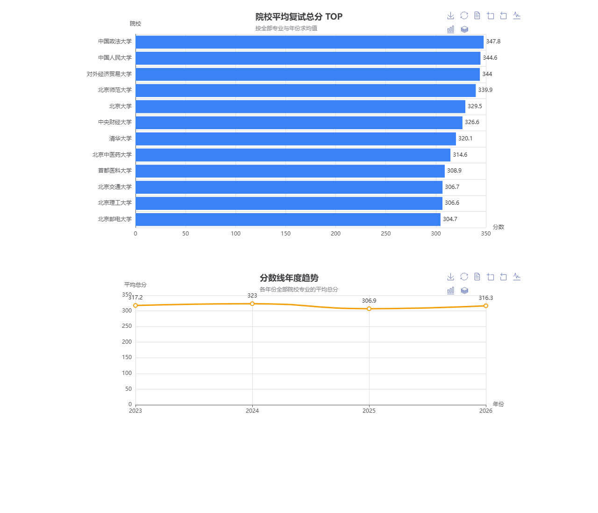
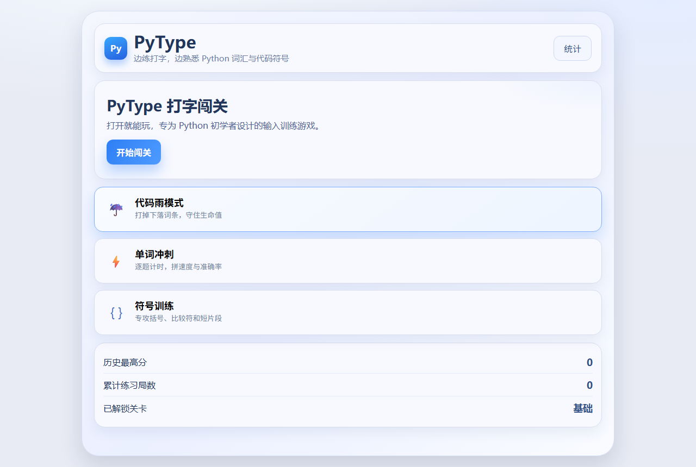

# Python 工具箱 · 数据采集 / 自动化 / 小工具

用 Python 把重复劳动变成一条命令。

这个仓库收录我日常写的小工具：**数据采集与清洗、可视化看板、浏览器自动化、纯前端小应用**。
每个项目都能独立运行，不依赖课程、不依赖私有环境，clone 下来就能跑。

---



---

## 项目一览

| # | 项目 | 一句话说明 | 技术栈 | 运行方式 |
|---|------|-----------|--------|---------|
| 01 | [PyType Lite 打字闯关](./01-typing-game) | 练 Python 关键词手速的网页小游戏，单文件零依赖 | HTML / CSS / JavaScript | 双击 `index.html` |
| 02 | [考研分数线看板](./02-kaoyan-dashboard) | 5791 条院校分数线 → 清洗 → 交互式可视化看板 | Python / pandas / pyecharts | `python analyze.py` |
| 03 | [元素定位工具箱](./03-selector-toolbox) | 粘贴 HTML，点一下就生成 XPath / CSS 选择器 | HTML / JavaScript | 双击 `index.html` |
| 04 | [Excel 批量合并](./04-excel-merger) | 一文件夹的表格合成一张总表，自动处理脏数据 | Python / pandas / openpyxl | `python excel_merge.py -i ./目录` |
| 05 | [Excel 自动清理](./05-excel-cleaner) | 脏表格一键洗白：洗表头、去空行空列重复、统一文本数字日期 | Python / pandas / openpyxl | `python excel_clean.py -i ./目录` |
| 06 | [ZOL 手机数据爬虫](./06-zol-phone-spider) | 抓取 160 条手机数据与图片，图片直接写进 Excel 第 2 列 | Python / requests / lxml / openpyxl | `python zol_phone_spider.py` |
| 07 | [Excel 按列拆分](./07-excel-splitter) | 一张总表按某列拆成几十个文件，或按行数切块 | Python / pandas / openpyxl | `python split_excel.py -i 总表.xlsx -c 客户` |

### 技术栈


---

## 快速开始

```bash
git clone https://github.com/132sheng/python-toolbox.git
cd python-toolbox

# 项目一、三：纯静态，浏览器直接打开
# 项目二、四：需要 Python 环境
pip install -r requirements.txt
cd 02-kaoyan-dashboard
python analyze.py --top 15          # 生成 dashboard.html
python analyze.py --school 清华大学   # 查单个院校明细

cd ../04-excel-merger
python excel_merge.py -i ./你的表格目录
```

生成的看板**自带 ECharts，离线可用**，不依赖任何 CDN。

---

## 目录结构

```
python-toolbox/
├── 01-typing-game/          # 打字闯关小游戏（单文件）
├── 02-kaoyan-dashboard/     # 分数线采集分析看板
│   ├── analyze.py           # 清洗 + 统计 + 出图
│   ├── assets/              # 离线 ECharts
│   └── data/                # 分数线数据
├── 03-selector-toolbox/     # 元素定位调试器（单文件）
├── 04-excel-merger/         # Excel 批量合并
│   ├── excel_merge.py       # 合并逻辑
│   └── README.md            # 参数与已知限制
├── 05-excel-cleaner/        # Excel 自动清理
│   └── excel_clean.py       # 清洗流程
├── 06-zol-phone-spider/     # ZOL 手机数据爬虫
│   ├── zol_phone_spider.py  # 采集 + 图片下载 + 写 Excel
│   └── .gitignore           # 图片与数据产物不提交
├── 07-excel-splitter/       # Excel 按列拆分
│   ├── split_excel.py       # 按列 / 按行数拆分
│   └── README.md            # 参数与已知限制
├── requirements.txt
└── LICENSE
```

---

## 项目详解

### 01 · PyType Lite 打字闯关

一个 36 KB 的单文件网页游戏，用来练 Python 关键字和常用函数的输入速度。



- 零依赖、零构建，双击即玩，可直接挂静态托管
- 逐题计时，实时统计得分、连击、正确率
- 基础 / 关键字 / 符号 三档关卡，按得分解锁

### 02 · 考研分数线看板

把散落在网页上的院校复试分数线，变成能筛选、能对比的可视化看板。

**做了什么：**

1. 采集 20 所院校、2023–2026 共 5791 条分数线记录
2. 用 pandas 做类型清洗（分数转数值、年份规整、缺失剔除）
3. 按院校聚合出平均分 / 最高分 / 最低分 / 专业覆盖数
4. 用 pyecharts 输出横向柱状图 + 年度趋势折线图，拼成一页看板

**能回答的问题：**

- 哪所院校的平均复试线最高？
- 分数线这几年是涨是跌？
- 某个学校某个专业，历年分数是多少？

> 数据来自公开页面，仅用于学习与技术演示。

### 03 · 元素定位工具箱

写爬虫时最费时间的不是请求，是"这个元素到底怎么定位"。


- 左边贴 HTML 源码，右边实时渲染出页面
- 在预览里点任意元素，直接给出它的 XPath、CSS 选择器
- 同时吐出元素文本、HTML、属性，方便判断该抓哪个字段
- 纯前端运行，页面内容不上传

生成的 XPath 是逐层带索引的绝对路径，CSS 选择器做了唯一性处理，复制进 requests / DrissionPage / Selenium 都能直接命中。

### 04 · Excel 批量合并

每周收上来十几个格式差不多但不完全一样的表格，手动复制粘贴半小时起步。

```bash
python excel_merge.py -i ./订单表
```

一条命令合成一张总表，并且顺手处理掉这些脏活：

- **表头不一致**：取并集，缺的格子留空，不会错位
- **空表 / `~$` 临时文件 / 损坏文件**：自动跳过，最后列清单
- **重复运行**：自动排除上次的结果，不会把数据合并两遍
- **来源可追溯**：每行加一列「来源文件」

> 支持 `.xlsx` / `.xlsm`，`.xls` 需先另存为新格式。

### 07 · Excel 按列拆分

合并的反向操作：一张总表要按部门、地区、客户分发，手动拆几十份最容易出错。

```bash
python split_excel.py -i 总表.xlsx -c 客户
```

- **按列拆**：每个值生成一个独立文件，文件名按单元格内容自动命名
- **按行切块**：`--rows 500`，每 500 行一个文件
- **文件名安全**：`/ : * ?` 这类非法字符自动替换，不会写到一半报错
- **不覆盖**：同名文件自动加 `_2`、`_3`
- **空值归堆**：没填内容的行统一进「未填写.xlsx」，不会丢

---

## 关于

一个在路上的 Python 开发者，专注**数据采集 / 自动化办公 / 小工具开发**。

- 有重复劳动想自动化、有数据想整理成报表，欢迎提 Issue 或邮件交流
- 仓库持续更新，每个工具都力求"clone 下来就能用"

## License

[MIT](./LICENSE) © 2026 132sheng